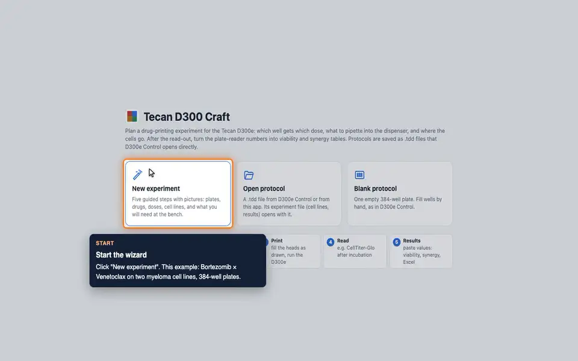
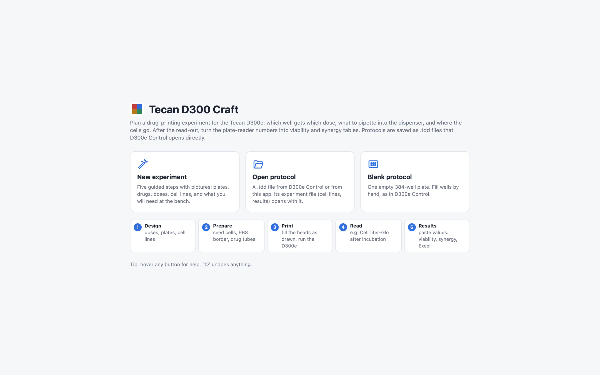
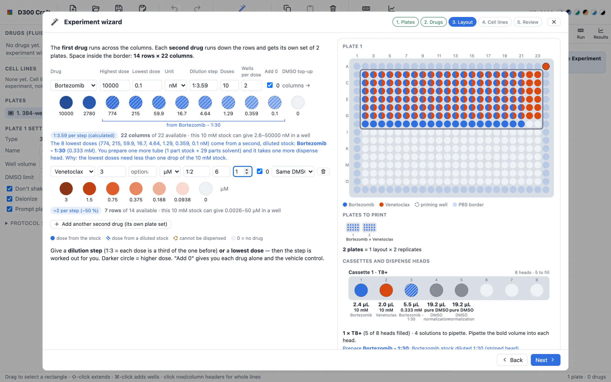
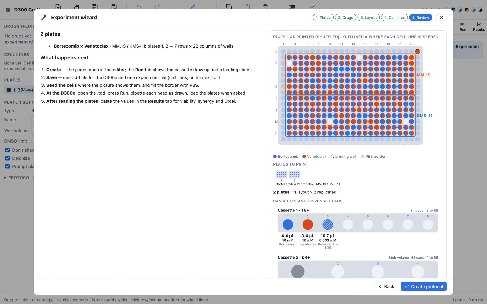
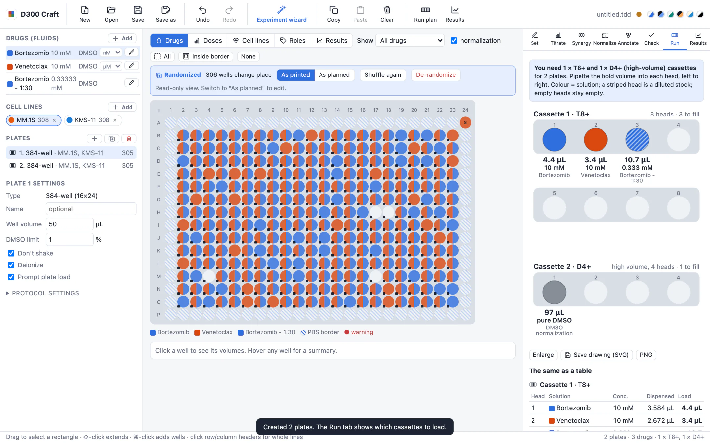
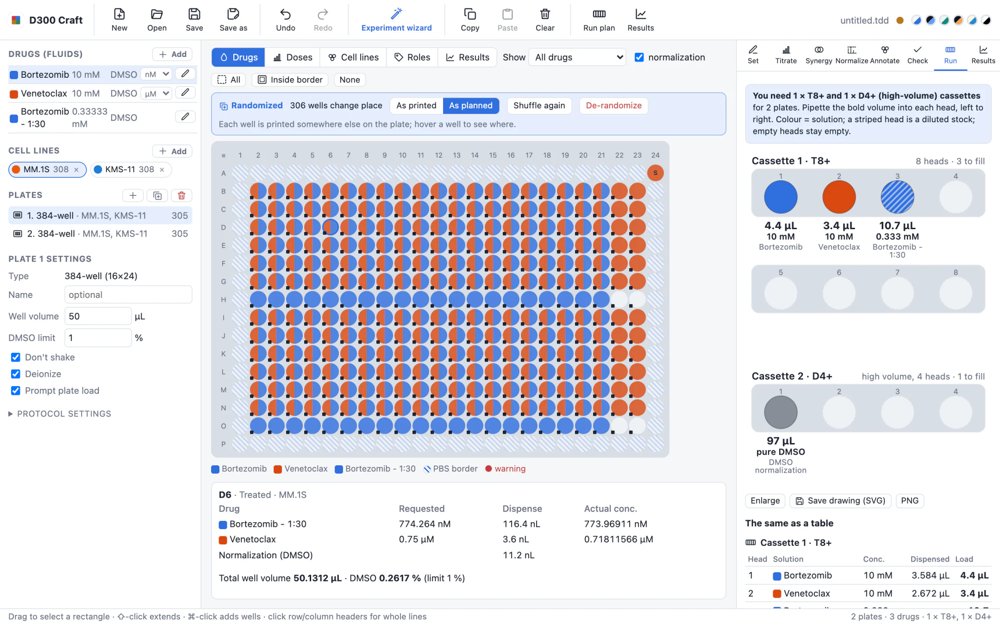
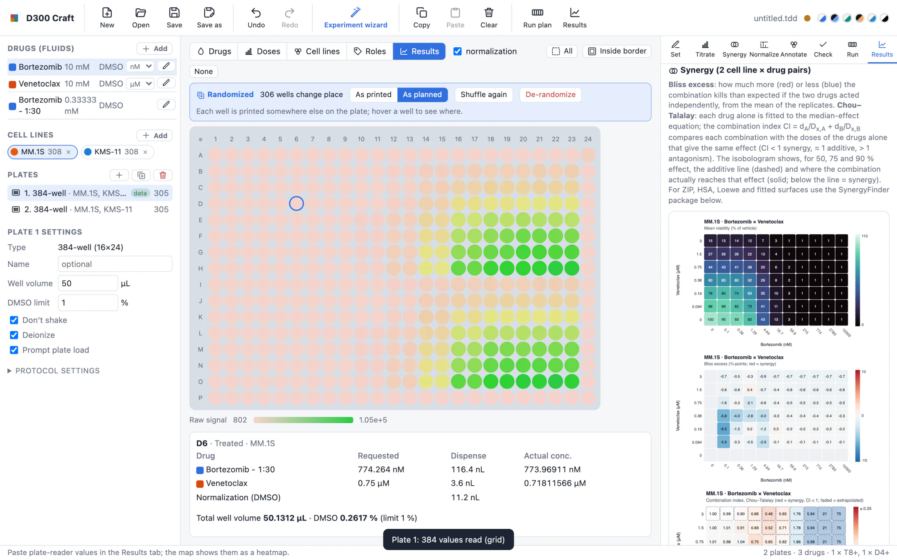
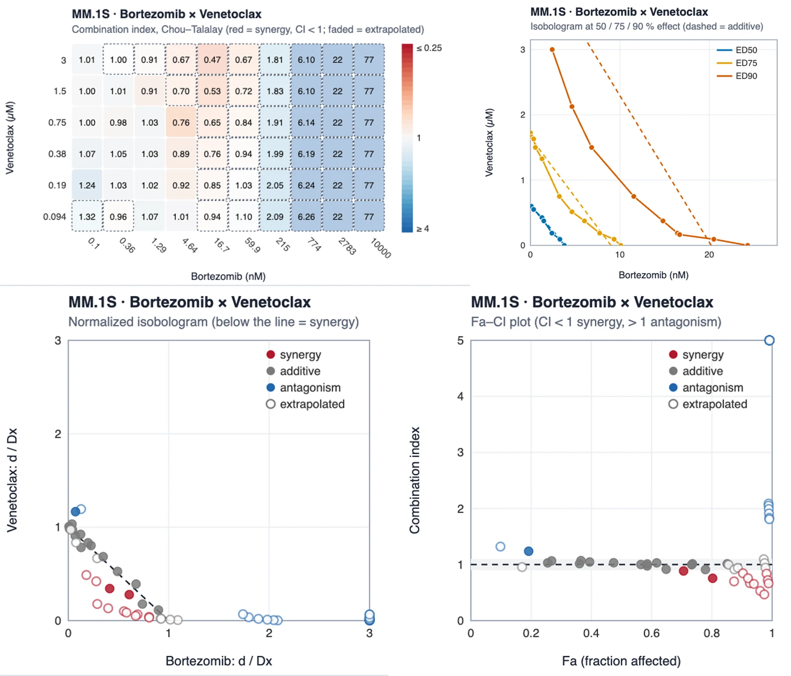

# Tecan D300 Craft

**Plan drug-printing experiments for the Tecan D300e digital dispenser on your own computer, then open
them in D300e Control and run.**

Craft walks you through an experiment in five steps (plates, drugs, doses, cell lines, review) and turns
it into a D300e protocol (`.tdd`) that D300e Control opens as it is. Along the way it tells you what to
prepare at the bench: which stocks and diluted stocks, which cassettes, how much to pipette into each
dispense head, where the cells and the PBS border go. After the plate reader, paste the values back in and
get viability, Bliss and Chou–Talalay synergy (combination index, isobolograms) and an Excel workbook, matched to
the wells where each dose was really printed.

Runs on **Mac, Windows and Linux**. Current version: **0.4.0**.

<p align="center">
  
</p>

> [!IMPORTANT]
> Always open a protocol made with Craft in **D300e Control** and check it (plate layout, doses, the
> cassette and loading table) before dispensing.

---

## Contents
- [Download](#download)
- [Install](#install)
- [Learn to use it: video, interactive tour, manual](#learn-to-use-it)
- [What it does](#what-it-does)
- [How an experiment goes](#how-an-experiment-goes)
- [What has been checked against D300e Control](#what-has-been-checked-against-d300e-control)
- [Files Craft writes](#files-craft-writes)
- [Command line and Claude](#command-line-and-claude)
- [For developers](#for-developers)

---

## Download

All files are on the **[Releases page](https://github.com/fgarbicz/tecan_d300e_craft/releases/latest)**.
Direct links for 0.4.0 (you need to be signed in to GitHub with access to this repository):

| Computer | Download | Size |
|---|---|---|
| **Windows 10 / 11** (64-bit) | [**Tecan.D300.Craft_0.4.0_x64-setup.exe**](https://github.com/fgarbicz/tecan_d300e_craft/releases/download/v0.4.0/Tecan.D300.Craft_0.4.0_x64-setup.exe) — recommended, no admin rights needed | 2.7 MB |
| | [Tecan.D300.Craft_0.4.0_x64_en-US.msi](https://github.com/fgarbicz/tecan_d300e_craft/releases/download/v0.4.0/Tecan.D300.Craft_0.4.0_x64_en-US.msi) — for IT / managed installs | 4.0 MB |
| **Mac** (Apple silicon: M1 and later) | [**Tecan.D300.Craft_0.4.0_aarch64.dmg**](https://github.com/fgarbicz/tecan_d300e_craft/releases/download/v0.4.0/Tecan.D300.Craft_0.4.0_aarch64.dmg) | 4.1 MB |
| **Linux** — Ubuntu, Debian | [**Tecan.D300.Craft_0.4.0_amd64.deb**](https://github.com/fgarbicz/tecan_d300e_craft/releases/download/v0.4.0/Tecan.D300.Craft_0.4.0_amd64.deb) | 4.2 MB |
| Linux — Fedora, RHEL | [Tecan.D300.Craft-0.4.0-1.x86_64.rpm](https://github.com/fgarbicz/tecan_d300e_craft/releases/download/v0.4.0/Tecan.D300.Craft-0.4.0-1.x86_64.rpm) | 4.2 MB |
| Linux — any distribution | [Tecan.D300.Craft_0.4.0_amd64.AppImage](https://github.com/fgarbicz/tecan_d300e_craft/releases/download/v0.4.0/Tecan.D300.Craft_0.4.0_amd64.AppImage) | 83 MB |
| **Manual** (everything below, for offline use) | [tecan-d300-craft-manual-pack.zip](https://github.com/fgarbicz/tecan_d300e_craft/releases/download/v0.4.0/tecan-d300-craft-manual-pack.zip) | 27 MB |

---

## Install

### Windows
1. Download **`…_x64-setup.exe`** and double-click it.
2. If Windows shows *"Windows protected your PC"* (SmartScreen): click **More info → Run anyway**.
   The installer is not code-signed yet; that is why Windows asks.
3. Click **Next → Next → Finish**. It installs for your user only (in `AppData\Local`), so no
   administrator password is needed. Untick *Create desktop shortcut* if you don't want one.
4. Start **Tecan D300 Craft** from the Start menu.

Craft uses Microsoft Edge WebView2, which Windows 10 and 11 already have; the installer adds it if missing.
To remove Craft: *Settings → Apps → Installed apps → Tecan D300 Craft → Uninstall*.

### Mac
1. Download the **`.dmg`**, open it and drag **Tecan D300 Craft** into **Applications**.
2. The first time only: **right-click** the app in Applications → **Open** → **Open**.
   (The app is not notarized by Apple yet, so a normal double-click is refused the first time. If you
   already double-clicked: *System Settings → Privacy & Security → Open Anyway*.)
3. After that, open it as any other app.

Intel Macs: no build yet — use the browser version (see [For developers](#for-developers)) or ask for one.

### Linux
- **Ubuntu / Debian:** `sudo apt install ./Tecan.D300.Craft_0.4.0_amd64.deb`, then start *Tecan D300 Craft*
  from the applications menu or run `d300-designer`.
- **Fedora:** `sudo dnf install ./Tecan.D300.Craft-0.4.0-1.x86_64.rpm`
- **Any distribution:** `chmod +x Tecan.D300.Craft_0.4.0_amd64.AppImage` and run it. On Ubuntu 24.04 and
  newer the AppImage also needs `sudo apt install libfuse2t64` (or use the .deb).

Needs WebKitGTK 4.1, which current desktop distributions include.

---

## Learn to use it

| | |
|---|---|
| 🎬 **Video tour** (4 min, captioned) | [Watch / download the MP4](https://github.com/fgarbicz/tecan_d300e_craft/releases/download/v0.4.0/tecan-d300-craft-tour.mp4) · [in the repository](docs/manual/tecan-d300-craft-tour.mp4) |
| 🖱️ **Interactive tour** — the same experiment step by step, at your own pace | Download the [manual pack](https://github.com/fgarbicz/tecan_d300e_craft/releases/download/v0.4.0/tecan-d300-craft-manual-pack.zip), unzip, double-click `interactive-tour.html` (arrow keys / space to step, ▶ to play). Or open [`docs/manual/demo.html`](docs/manual/demo.html) from a clone of the repository. |
| 📘 **User manual** (PDF, 24 pages) — install, glossary, the full tour, at the D300e, editing by hand, results, troubleshooting | [Download the PDF](https://github.com/fgarbicz/tecan_d300e_craft/releases/download/v0.4.0/tecan-d300-craft-manual.pdf) · [view in the repository](docs/manual/tecan-d300-craft-manual.pdf) |

The tour follows one real-sized example: **Bortezomib × Venetoclax on two myeloma cell lines (MM.1S and
KMS-11), 384-well plates, 50 µL per well, 2 replicate plates, randomized within each cell line.**

---

## What it does

### Start: a guided experiment, an existing protocol, or a blank plate
Open any protocol saved by D300e Control, start from an empty plate, or let the **experiment wizard**
build the whole layout.



### Experiment wizard: doses you can see
Give the highest and lowest dose (or a dilution step) and the number of doses; each drug can be shown in
its own unit (mM, µM, nM, pM). Craft draws every dose as a tube and works out when a dose needs **less
than one drop** of the stock — then it adds a **diluted stock** of the same drug (D300e Control's
"fluid shift / extend") and tells you how to make it. The plate on the right updates as you type.



### Review: what you will need, before you create anything
Plates to print, cell lines, the cassettes and what goes into each dispense head, and the five steps
from here to results.



### The plate map: edit anything by hand
Every well, with its drugs, DMSO top-up, cell line and role. Randomized plates can be viewed **as planned**
(tidy, where you edit) or **as printed** (where each dose really lands). Set, Titrate, Synergy (two- or
three-drug matrices), Normalize, Annotate, Copy/Paste and Undo work as in D300e Control. **Check** lists
everything the D300e would refuse or warn about.



### Run plan: what to pipette into which head
Which cassettes to insert (T8+, D4+), what solution goes into each head and the volume to load — as a
drawing you can print or save, and as a table. These are the numbers D300e Control asks for when you
press Run.



### Results: viability, synergy, Excel
Paste the plate reader's values (straight from its Excel export). Craft matches them to where each dose
was printed — randomization included — and shows % of vehicle, a heat map and Bliss synergy per cell line.
Export an Excel workbook (one row per well plus replicate statistics), or a SynergyFinder package for
ZIP / HSA / Loewe.



### Chou–Talalay: combination index and isobolograms
Each drug alone is fitted to the median-effect equation between 10 and 90 % effect (m, Dm and r shown; warnings for
r < 0.90 and for an effect that levels off at the top — usually a reader floor: mark blank wells).
Every combination then gets a **combination index** — CI = d<sub>A</sub>/D<sub>x,A</sub> + d<sub>B</sub>/D<sub>x,B</sub>,
comparing it with the doses of each drug alone that give the same effect: CI < 1 synergy, ≈ 1 additive, > 1
antagonism, with Chou's categories (Pharmacol Rev 2006) and dose-reduction indices. Four figures per cell line and
pair, each saved as SVG or PNG: the CI matrix, a **classic isobologram** at 50 / 75 / 90 % effect (dashed: additive;
solid: where the combination really reaches that effect — below the line is synergy), the **normalized
isobologram** and the **Fa–CI plot**. The Excel export gets a *Chou-Talalay CI* and a *Median-effect fits* sheet.



<sub>Figures from the tour's simulated readout, where the two drugs act independently: within the doses tested alone
the CI stays near 1. Each drug alone is fitted between 10 and 90 % effect, so that well-to-well noise near 0 and the
reader floor near 100 % do not bend the slope (CompuSyn fits every point; that fit is listed in Excel for comparison).
CIs that need doses beyond those tested alone are shown faded / open and are not counted in the summary.</sub>

---

## How an experiment goes

1. **Design** — in Craft: plates, drugs, doses, cell lines (wizard or by hand). **Save** writes the `.tdd`
   and its experiment file.
2. **Prepare** — make the stocks and diluted stocks Craft lists; seed the cells as the *Cell lines* view
   shows; fill the border with PBS or medium.
3. **Print** — copy the `.tdd` to the D300e computer (e.g. OneDrive or a USB stick), *File → Open* it in
   D300e Control, compare plate 1 with Craft's *As printed* view, press **Run**, and load the heads as the
   Run plan shows (D300e Control shows the same numbers).
4. **Read** — e.g. CellTiter-Glo after incubation.
5. **Results** — open the experiment in Craft again, paste the values in the Results tab, export.

---

## What has been checked against D300e Control

Everything was compared with **D300e Control 4.0.1** in simulation mode on a Windows computer (not on a
physical run).

| Checked | Result |
|---|---|
| Every protocol saved by D300e Control opens and saves back **byte-for-byte identical**; Craft's files open in D300e Control with the designed doses (including a randomized plate: 850 of 850 rows) | all files tried |
| Dispensed volume per well, 27 simulated runs | **26,688 of 26,701** rows identical |
| Cassettes, dispense heads and load volumes | identical on every run compared |
| DMSO top-up ("% of assay volume", "same DMSO in every well") | identical |
| Diluted stocks: factors offered, split between stock and diluted stock | identical where tested |
| Windows, Mac and Linux builds: open a D300e protocol, save it, run plan | same files, same head loads on all three; the Windows-saved file opens in D300e Control |

**Not yet checked:** the minimum load for aqueous solutions; D300e Control's own pre-run warnings;
13 wells in runs using "to highest total" normalization (a rounding tie). Read D300e Control's warnings
and loading table before the run. Details: [`docs/format_notes.md`](docs/format_notes.md).

The results analysis is checked by Craft's own tests, not against another analysis program — check your
first analysis against a hand calculation.

---

## Files Craft writes

| File | What it is | Where it goes |
|---|---|---|
| `name.tdd` | The D300e protocol — exactly the format D300e Control 4.0.1 writes | to the D300e computer |
| `name.craft.json` | The experiment around it: cell lines, PBS border, well roles, plate-reader results | keep it next to the `.tdd` so the results open later |

Each save is cross-checked: the protocol is read back and written again by an independent engine, and must
come out byte-for-byte the same, otherwise nothing is written.

---

## Command line and Claude

`bin/d300craft` is the programmable side of the app:

```sh
bin/d300craft example                      # print an example experiment spec (JSON)
bin/d300craft design spec.json --out DIR   # → DIR/name.tdd, name.craft.json, name_plan.md: drugs to prepare,
                                           #   cassettes and per-head loads, cell seeding, PBS, warnings
bin/d300craft plan  file.tdd               # bench plan for any existing protocol
bin/d300craft check file.tdd               # warnings only (exit status 1 if any)
bin/d300craft dosemap file.tdd --out map.svg
```

Claude uses it through the skill [`.claude/skills/d300-plate-design`](.claude/skills/d300-plate-design), so
*"design synergy plates for these drugs on these cells"* returns a checked protocol and bench plan.
Designs go in `experiments/` (not in git).

---

## For developers

**Clean-room:** built only from protocol files saved by D300e Control and the vendor user guide. Tecan's
software is not decompiled or redistributed. D300e Control (simulation mode) is used as the reference
("oracle") for differential tests.

### Layout
- `app/` – the interface (HTML/JS), shared by the desktop app and the browser version
- `src/xmltree.js` – ordered XML parser/writer matching .NET XmlWriter output (CRLF, 2-space indent, `<X />`)
- `src/tdd.js` – protocol model: fluids, plates, wells, backfills; byte-identical round-trip
- `src/dispense.js` – dispense engine (volumes, rounding, normalization) matching D300e Control's run reports
- `src/cassette.js` – run plan: cassettes (T8+/D4+), dispense heads, load volumes
- `src/experiment.js` – experiment layer (cell lines, PBS border, well roles, readouts) and the wizard
- `src/analysis.js` – plate-reader analysis and the Excel workbook
- `crates/d300-core` – Rust engine (save cross-check, differential tests); `crates/d300-app` – Tauri 2 desktop shell
- `fixtures/reference/` – read-only files saved by the real software (test oracle), incl. probe protocols and their simulated runs
- `docs/` – format notes, spec extracted from the user guide, open questions; `docs/manual/` – manual, tour, video

### Run, build, test
- Browser version: `bin/serve.sh` → http://127.0.0.1:8931/app/ (Save downloads files instead of writing them in place)
- Tests: `npm test` (Node ≥ 20, no dependencies) and `cargo test -p d300-core` — byte-identical round-trips of every
  protocol saved by D300e Control 4.0.1 and the full D3 run report (5752 dispense rows)
- Mac app: `cd crates/d300-app && cargo tauri build` → `.app` and `.dmg` in `target/release/bundle/`
  (needs `cargo install tauri-cli --version "^2" --locked`)
- Windows and Linux installers: GitHub Actions, [`.github/workflows/build.yml`](.github/workflows/build.yml) — run it
  from the Actions tab or push a `v*` tag; the installers are attached to the run as artifacts

### Regenerate the manual after interface changes
Start `bin/serve.sh`, then in `tools/manual`: `npm ci`, then
`node record.mjs shots && node record.mjs video && node build.mjs` (needs Google Chrome, ffmpeg, cwebp).
The tour script is [`tools/manual/steps.mjs`](tools/manual/steps.mjs). The README preview
(`docs/images/tour-preview.webp`) is cut from the video with ffmpeg + `img2webp`.
